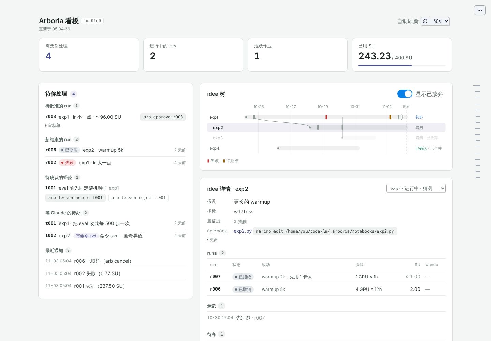
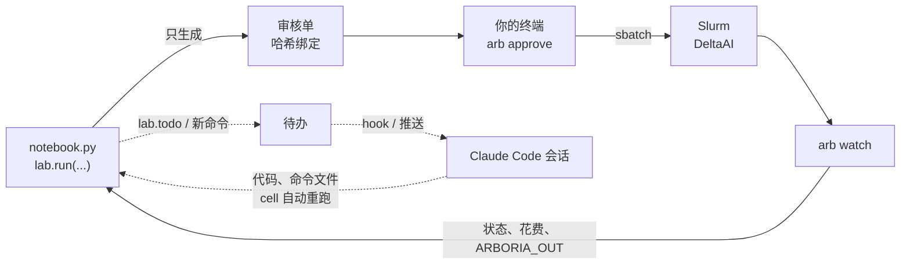

# Arboria

**把算力层封装起来的 AI 原生 ML 研究工作流**

**文档：[arboria.cwx.world](https://arboria.cwx.world)**

[](https://github.com/legallchaperone/arboria/actions/workflows/tests.yml)


[](LICENSE)

> **In English.** Arboria (`arb`) keeps the state of ML research — ideas, runs, notes, decisions — in a local SQLite ledger outside the Claude Code chat, and gives every idea its own git worktree and [marimo](https://marimo.io) notebook. Claude writes the code and reusable analysis commands; you write the notebook, and every Slurm job (with NCSA DeltaAI billing built in) needs your approval, typed in your own terminal, of a hash-bound review card. A read-only dashboard shows what is waiting for you, how ideas branched, and where the compute went. The docs are in Chinese, with a short English overview at [arboria.cwx.world/en](https://arboria.cwx.world/en/).

<picture>
  <source media="(prefers-color-scheme: dark)" srcset=".github/assets/dashboard-dark.png">
  <source media="(prefers-color-scheme: light)" srcset=".github/assets/dashboard-light.png">
  
</picture>

<sub>只读看板 `arb ui`（图中是测试用的演示数据）：左边是等你处理的事，右边是 idea 怎么随时间分叉，以及选中 idea 的详情。</sub>

## 为什么

- **状态活在对话之外。** Claude Code 的会话是一次性的；idea、run、笔记、决定都记在本地账本（`.arboria/ledger.db`）里，只能经 `arb` 写入。新会话开始时 hook 自动注入当前 idea 的状态和待办。
- **一个 idea 一个 notebook。** 每个 idea 有自己的分支、worktree 和 marimo notebook；每次 run 都是工作区的快照，不动你的分支和暂存区。
- **上集群的每个 run 都由你批准。** Claude 和 notebook 只能生成审核单；只有你在自己的终端里运行 `arb approve`，作业才会提交到 Slurm。
- **算力层被封装起来。** 分段、计费（含 DeltaAI 的计费规则）、预算、Duo 登录、日志观察和失败自动取消都由 `arb` 处理，不用手写 `sbatch`、不用 ssh。
- **Claude 写代码和命令，你写 notebook。** 你在 notebook 里写 `lab.svd(r, ask="画奇异值")`，命令还不存在时交给 Claude 去写；写好后 cell 自动重跑，之后每次都直接运行存下来的函数。

## 工作方式



实线是你和集群之间的路径，虚线是 Claude 那一侧：它从待办里拿活，写代码和 notebook 命令，但碰不到批准和集群。

## 快速开始

需要 Python ≥ 3.11、git ≥ 2.31 和 [uv](https://docs.astral.sh/uv/)。

```bash
# 安装（带 marimo：notebook 和看板都要）
git clone https://github.com/legallchaperone/arboria.git && cd arboria
uv tool install --force '.[ui]'

# 在你的实验代码仓库里
cd ~/code/myproj
arb init                  # .arboria/ 账本 + arboria.toml 模板
$EDITOR arboria.toml      # default_machine、[wandb] entity/project、[run] command，然后 commit
arb install-claude        # SessionStart hook、权限规则、CLAUDE.md 区块
arb idea new lr-warmup --hypothesis "warmup 能稳定早期训练" --metric "val/loss @10k steps"
cd ../myproj-lr-warmup && marimo edit notebook.py   # 或在 VS Code 里用 marimo 扩展打开
```

marimo 默认打开 notebook 时不运行 cell；建议在 `~/.config/marimo/marimo.toml` 里设 `[runtime]` `auto_instantiate = true`，一打开就能看到 run 的状态。

机器配置写在 `~/.config/arboria/clusters.toml`（示例 [`examples/clusters.toml`](examples/clusters.toml)，`arb machine init deltaai --write` 可以在集群上实测后生成）。

在 notebook 里：

```python
from arboria import lab

r = lab.run(reason="warmup 1k", gpus=4, time="12h", set={"lr": 3e-4})  # 只生成审核单
r                                   # r001 · 待批准 · warmup 1k，下面一行是 arb approve r001

r.metrics(["val/loss"])             # wandb 曲线
lab.plot(["r001", "r002"], "val/loss")                     # 内置分析：plot / diff / spend
lab.todo("把 eval 改成每 500 步一次")                      # 留给 Claude 的待办
lab.svd(r, ask="对 attention 权重做 SVD，画前 20 个奇异值")  # 自定义命令：第一次交给 Claude 写
```

然后在你自己的终端里：

```bash
arb card r001       # 看审核单
arb approve r001    # 输入 r001 确认后提交
arb watch           # 跟踪；观察期内 loss NaN / CUDA OOM 会自动取消
```

## 种子：还没有仓库的想法

还在酝酿、不属于任何仓库的想法记成**种子**，也就是还没有仓库的 idea：在仓库外 `arb idea new NAME "一句话想法"`，它在 `~/arboria/seeds/NAME.py` 有自己的 marimo notebook（仓库外的 `arb idea list/show/set/drop/revive` 都作用于种子；在还没 `arb init` 的仓库里会报错，不会记成种子）。想清楚了，在目标仓库里 `arb idea plant NAME`：它变成一个普通 idea，notebook 开头链接回种子，并带上种子里的 markdown 思路。种子只由你写，Claude 只读；`arb ui` 在仓库外打开种子园，`arb install-claude --home` 让 Claude Code 在 `~/arboria` 里也有 hook 和规则。见[文档 · 种子园](https://arboria.cwx.world/guides/seeds/)。

## 常用命令

| 命令 | 作用 |
| --- | --- |
| `arb init` | 初始化当前仓库（幂等） |
| `arb install-claude [--main \| --user \| --home]` | 写入 hook 和权限规则，同步 CLAUDE.md 区块（`--home`：种子园） |
| `arb idea new NAME --hypothesis T --metric T` | 新 idea：分支、worktree、notebook |
| `arb idea show [NAME]` / `arb idea list` | 一个 idea 的假设、指标和 run / 所有 idea |
| `arb idea drop [NAME]` / `arb idea close [NAME] --merge` | 存档后放弃 / 合并一个 idea |
| `arb submit --reason T [--from RUN] [--set K=V] [--gpus N] [--time DUR]` | 只在本地生成快照和审核单（`lab.run` 的命令行版） |
| `arb card RUN` | 按当前配置重算并显示审核单 |
| `arb approve RUN` | **只在你的终端里**：确认后提交到 Slurm |
| `arb reject RUN [--reason T]` | 拒绝一个待批准的 run |
| `arb watch` / `arb poll [RUN]` | 跟踪作业、花费，结束后拉回输出 |
| `arb logs RUN` / `arb remote ls RUN` | 看集群上的日志和文件（代替 ssh） |
| `arb cancel RUN` | 取消一个 run 的所有作业 |
| `arb status` | 当前 idea（或所有 open idea）的概览 |
| `arb note TEXT [--run ID] [--confidence X]` | 你的笔记（Claude 不能写） |
| `arb todo list` / `arb todo done ID --result T` | notebook 留下的待办 |
| `arb ui [--home]` | 打开只读看板（仓库外是种子园） |
| 仓库外：`arb idea new NAME ["一句话想法"]` / `list` / `show NAME` | 种子：还没有仓库的 idea，各有一个 notebook（`new` 只由你） |
| 仓库里：`arb idea plant NAME` | 把种子种进这个仓库，成为 idea（只由你） |
| 仓库外：`arb idea drop NAME` / `revive NAME` | 放弃一个种子 / 让它回到思考中（只由你） |
| `arb doctor [NAME]` | 只读检查机器配置、ssh 和集群 |

每个命令和参数见 [CLI 命令参考](https://arboria.cwx.world/reference/cli/)。

## 安全模型

- **只有 `arb approve` 能到达 Slurm**，而且只在真正的终端里：检测到 Claude Code 的环境变量、stdin 不是 TTY 或正在运行 notebook 命令时直接拒绝，然后要你输入 run id 确认。提交前代码再查一遍账本里有你的批准；没有任何自动批准的代码路径，`lab` 里也没有批准函数。
- **批准绑定审核单哈希**：快照、命令、资源、账户、分区、分段计划和环境都算进哈希，任何一项变了，旧的批准就作废。
- **Claude 能读 notebook，不能改**：`arb install-claude` 禁止 Claude 编辑 notebook、账本和备份，并禁止它直接用 `sbatch`/`srun`/`scancel`/`ssh`/`scp`/`rsync`、`arb approve`、`arb lesson accept`。
- **看板只读**：账本以只读模式打开，不起进程、不联网，没有会动手的按钮，批准等操作只显示成可复制的命令。
- **这些是护栏，不是沙箱。** 它们防的是 Claude “顺手照做”（被一句话、一段日志或一个文件带着去提交、批准），不防同一台机器上以你的身份运行的蓄意对手。notebook 命令由 Claude 写、在你的 kernel 里以你的权限运行，用之前先看 diff。

细节见[文档 · 安全模型](https://arboria.cwx.world/reference/security/)。

## 状态

这是一个个人研究工具，正在积极开发，接口可能会变。

- **测试覆盖（CI 在 Python 3.11 / 3.13 上运行）**：账本、idea 生命周期、快照、hook、CLAUDE.md 区块与经验；提交、审核单、批准、分段、计费、poll / watch / cancel（`FakeSlurm` 和 mock 的 ssh）；notebook、`lab` API、待办、notebook 命令和自动重跑（真的 marimo）；只读看板。
- **在 DeltaAI 上实测过**：机器 profile 和计费权重，`arb machine init` / `arb doctor`。
- **还没做**：通过 `SshSlurm` 的第一个真实 run（submit → approve → watch → 拉回输出，核对日志、`sacct` 状态和花费），以及计算节点上的 Python 环境。
- **之后**：提交前检查和独立的 AI 审稿人、基于历史的时长和花费估计。

## 文档

- [arboria.cwx.world](https://arboria.cwx.world)：中文文档（入门、指南、每个命令和配置项、安全模型、DeltaAI 说明），源码在 [`docs/`](docs/)。
- [设计说明](https://claude.ai/artifact/NCqpKzbhDfAXSURgGTc1zn)（中文网页；可能是私有链接）。
- [CLAUDE.md](CLAUDE.md)：给开发这个工具的 Claude 看的约束和进度。

## 许可证

[MIT](LICENSE) © 2026 legallchaperone
